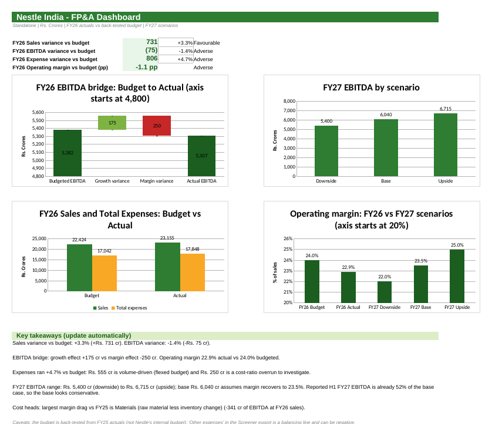
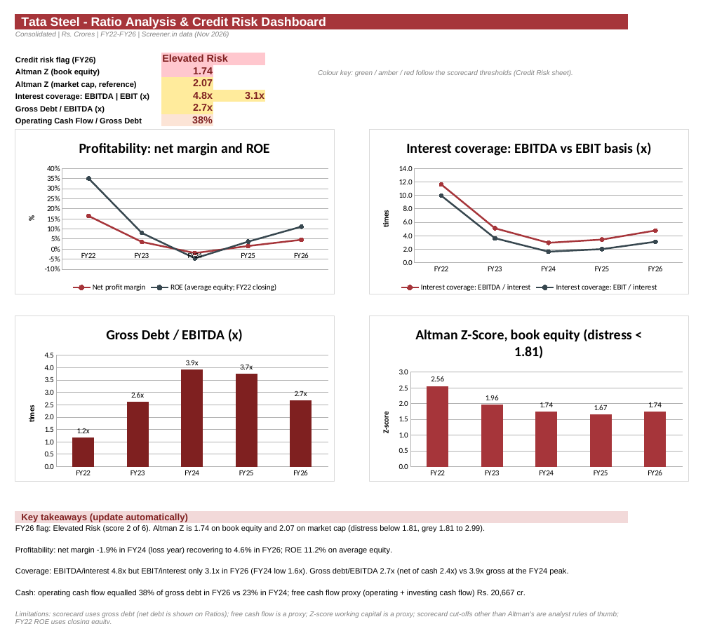
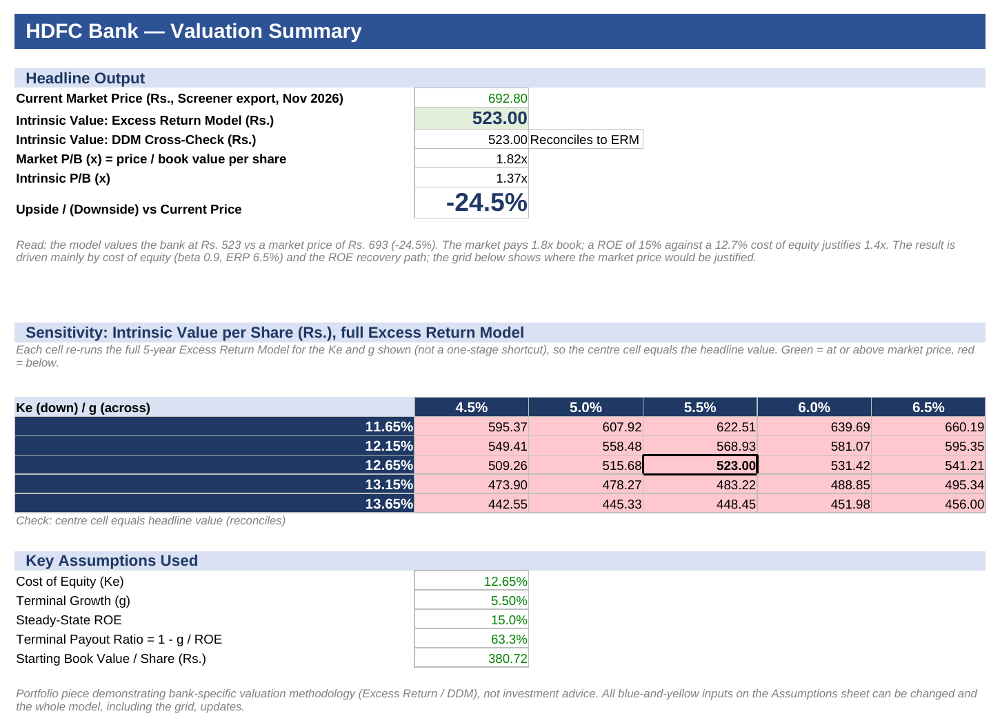

# Finance Portfolio

<p align="center">
  
  
  
  
  
</p>

<p align="center">
  <strong>B. Sreeja</strong><br>
  BBA graduate in Banking and Finance | Mumbai, India<br>
  Financial Analysis • FP&A • Credit Analysis • Valuation
</p>

---

## Start here: review the financial models

| Project | Core finance question | Inspect |
| --- | --- | --- |
| [01 · Nestlé India FP&A model](README_Nestle.md) | Did FY26 deliver its budget, and what drove the EBITDA gap? | [Workbook](nestle_fpa_model.xlsx) · [Dashboard preview](nestle_dashboard.png) · [Raw data](Raw_Data_Nestle_India.xlsx) · [Project notes](README_Nestle.md) |
| [02 · Tata Steel credit dashboard](README_TataSteel.md) | How strong is Tata Steel's credit after a loss-making cycle? | [Workbook](tata_steel_credit_dashboard.xlsx) · [Dashboard preview](tata_dashboard.png) · [Raw data](Raw_Data_Tata_Steel.xlsx) · [Project notes](README_TataSteel.md) |
| [03 · HDFC Bank valuation](README_HDFC.md) | What is HDFC Bank worth on a bank-appropriate model, and do two methods agree? | [Workbook](hdfc_valuation_model.xlsx) · [Summary preview](hdfc_summary.png) · [Raw data](Raw_Data_HDFC_Bank.xlsx) · [Project notes](README_HDFC.md) |

**Overview document:** [Portfolio_Overview.pdf](Portfolio_Overview.pdf)

### How to review and validate

1. Start with the question and metric definitions on each workbook's **Cover** sheet.
2. Open the **Raw_Data** sheet. It is the unedited Screener.in export, copied cell for cell. Every input on the **Historicals** sheet is a formula pointing to it, and the same export is also in this repo as a separate file (`Raw_Data_*.xlsx`) so you can compare.
3. Check the reconciliation cells built into each model: Nestlé's cost lines tie to total expenses and the EBITDA bridge reconciles; Tata Steel's balance sheet ties; HDFC's P&L ties to profit before tax and the DDM equals the excess return value.
4. Read the assumptions (yellow cells) against reported data, and the limitations listed in each project's notes file.
5. The company data is real (published financials via Screener.in). The budget, forecast and valuation assumptions are my own exercises, so treat the outputs as educational analysis, not investment advice or company guidance.

---

## Overview

I am a **BBA graduate in Banking and Finance** (Jain (Deemed-to-be University), Bangalore, 2022 to 2025, CGPA 8.52). This repository holds three Excel projects built on real listed-company data, each answering a different finance question:

- **FP&A:** budgeting, variance analysis, an EBITDA bridge, flexed budgets, cost-head analysis and scenario forecasting
- **Credit analysis:** profitability, leverage, coverage and cash-flow ratios, an Altman Z-Score and a risk scorecard
- **Valuation:** a bank-appropriate excess return model, cross-checked with a dividend discount model

I'm looking for an opportunity to grow as a finance professional.

---

## Featured projects

### 01 · Nestlé India: FP&A budget vs actual and FY27 forecast
**Workbook:** [nestle_fpa_model.xlsx](nestle_fpa_model.xlsx) | [Download](https://github.com/sreeja-243/finance-portfolio/raw/main/nestle_fpa_model.xlsx)



- FY26 sales were **+3.3%** (+Rs. 731 cr) vs a back-tested budget, but EBITDA was **-1.4%** (-Rs. 75 cr); operating margin 22.9% vs 24.0%.
- EBITDA bridge: **+Rs. 175 cr** from growth, **-Rs. 250 cr** from margin.
- Expenses ran 4.7% over budget: Rs. 555 cr volume-driven, **Rs. 250 cr a cost-ratio overrun**. Using the raw cost lines, **materials** were the largest drag (-Rs. 341 cr, 37.2% to 38.6% of sales).
- FY27 EBITDA scenarios: Rs. 5,400 cr / **6,040 cr** / 6,715 cr. Cross-check: reported H1 FY27 EBITDA (+35% on H1 FY26) is already 52% of the base case, so the base looks conservative.

[Project notes](README_Nestle.md)

### 02 · Tata Steel: ratio analysis and credit risk dashboard, FY22 to FY26
**Workbook:** [tata_steel_credit_dashboard.xlsx](tata_steel_credit_dashboard.xlsx) | [Download](https://github.com/sreeja-243/finance-portfolio/raw/main/tata_steel_credit_dashboard.xlsx)



- Net profit swung from Rs. 40,154 cr (FY22) to a **Rs. 4,437 cr loss (FY24)** and back to Rs. 10,794 cr (FY26); net margin -1.9% to 4.6%.
- Gross debt / EBITDA **3.9x to 2.7x** (net of cash 3.5x to 2.4x). Interest cover 4.8x on EBITDA but only **3.1x on EBIT**.
- Operating cash flow covers 38% of gross debt (23% in FY24).
- Altman Z-Score **1.74** on book equity (2.07 on market cap); scorecard **2 of 6, "Elevated Risk"**.

[Project notes](README_TataSteel.md)

### 03 · HDFC Bank: excess return valuation with DDM cross-check
**Workbook:** [hdfc_valuation_model.xlsx](hdfc_valuation_model.xlsx) | [Download](https://github.com/sreeja-243/finance-portfolio/raw/main/hdfc_valuation_model.xlsx)



- Intrinsic value **Rs. 523 per share** vs Rs. 692.80 market price (Screener export, Nov 2026): **-24.5%**. Market P/B 1.82x vs 1.37x supported by the model.
- The **DDM equals the excess return value exactly** once terminal payout is set to 1 - g/ROE, which keeps growth consistent with ROE.
- A 5 x 5 grid re-runs the full model for cost of equity 11.65% to 13.65% and growth 4.5% to 6.5%: Rs. 443 to Rs. 660, and no cell reaches the market price.
- FY26 ROE computed from the data is 13.7%; the forecast assumes a recovery to 15%.

[Project notes](README_HDFC.md)

---

## Skills demonstrated

- **Excel:** formula-driven models, SUMPRODUCT, scenario analysis, linked dashboards, conditional formatting, charts
- **FP&A:** budget vs actual, favourable/adverse variance, EBITDA bridge, flexed budget, cost-head analysis, forecast cross-checks
- **Credit and ratio analysis:** coverage, leverage, net debt, cash-flow metrics, Altman Z-Score, risk scoring
- **Valuation:** CAPM, residual income, DDM, sensitivity analysis
- **Modelling practice:** inputs linked to a raw-data sheet, check cells, assumptions and limitations documented
- **Other skills (not used in these three projects):** SQL, Power BI

## Education and certifications

- BBA in Banking and Finance, Jain (Deemed-to-be University), Bangalore, 2022 to 2025. CGPA 8.52
- Advanced Excel (Udemy)
- HR Generalist Practices (Udemy)
- Excel Using AI Workshop (Be10x)
- [Certificates](https://drive.google.com/drive/folders/1Dex55DiEAYplRLFDqPmvpr9-BgIqX8gz)

## Data and sources

| File | Source |
| --- | --- |
| [Raw_Data_Nestle_India.xlsx](Raw_Data_Nestle_India.xlsx) | Screener.in Excel export, Nestlé India (standalone), downloaded Nov 2026 |
| [Raw_Data_Tata_Steel.xlsx](Raw_Data_Tata_Steel.xlsx) | Screener.in Excel export, Tata Steel (consolidated), downloaded Nov 2026 |
| [Raw_Data_HDFC_Bank.xlsx](Raw_Data_HDFC_Bank.xlsx) | Screener.in Excel export, HDFC Bank (consolidated), downloaded Nov 2026 |

The market prices in the models are the "current price" in these exports. HDFC's risk-free rate (10-year G-Sec) and beta come from public sources noted on its Assumptions sheet.

## How to use the workbooks

1. Open in Excel; formulas are calculated and values are cached.
2. Colour code: **blue** = input, black = formula, **green** = link to another sheet, **yellow fill** = key assumption to change.
3. Change a yellow cell (for example FY27 margin, cost of equity, terminal growth) and the dashboards and takeaways update.

## Repository structure

```
README.md                          this page
Portfolio_Overview.pdf             overview of all three projects
README_Nestle.md                   Nestlé project notes
README_TataSteel.md                Tata Steel project notes
README_HDFC.md                     HDFC Bank project notes
nestle_fpa_model.xlsx              workbook 1
tata_steel_credit_dashboard.xlsx   workbook 2
hdfc_valuation_model.xlsx          workbook 3
Raw_Data_Nestle_India.xlsx         raw export 1
Raw_Data_Tata_Steel.xlsx           raw export 2
Raw_Data_HDFC_Bank.xlsx            raw export 3
nestle_dashboard.png               dashboard preview
tata_dashboard.png                 dashboard preview
hdfc_summary.png                   summary preview
```

## Contact

**B. Sreeja** | Mumbai, India
Email: [sreeja243b@gmail.com](mailto:sreeja243b@gmail.com)
LinkedIn: [linkedin.com/in/sreeja-b-2141b1447](https://www.linkedin.com/in/sreeja-b-2141b1447/)
GitHub: [github.com/sreeja-243](https://github.com/sreeja-243)

---

> Educational portfolio exercises. Company data is published financials via Screener.in; budgets, forecasts and valuation assumptions are my own. Not investment research, recommendations or price targets.
